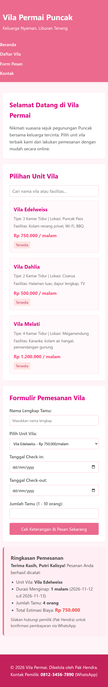

# Ujian Tengah Semester - Teknologi Web
Aplikasi Pemesanan Vila Berbasis Web (Vila Permai)

Identitas Mahasiswa:
- Nama Mahasiswa: Putri Kalisya Salsabila
- NIM: 2401130517
- Nama Repository: uts_vilapermai_2401130517

Deskripsi Fitur:
Aplikasi web statis sederhana berbasis HTML, CSS, dan JavaScript murni untuk pemesanan unit vila di Puncak (Vila Permai) tanpa memerlukan server atau back-end.

Cara Menjalankan Halaman:
1. Unduh atau clone repository ini ke komputer Anda.
2. Buka folder proyek uts_vilapermai.
3. Klik dua kali pada file index.html atau buka menggunakan browser web apa saja (Chrome, Firefox, Edge).

Daftar Fitur Utama:
- Tiga pilihan kartu unit vila interaktif dengan data yang bersumber dari array objek JavaScript.
- Filter pencarian real-time berdasarkan nama atau fasilitas vila.
- Formulir & Perhitungan Otomatis: Perhitungan total biaya menginap berdasarkan jumlah malam secara otomatis sebelum tombol pesan ditekan.
- Penyimpanan Lokal: Menyimpan nama tamu terakhir menggunakan localStorage.
- Desain Responsif: Tampilan menyesuaikan perangkat seluler, tablet, maupun laptop.

Tangkapan Layar Halaman Web:

